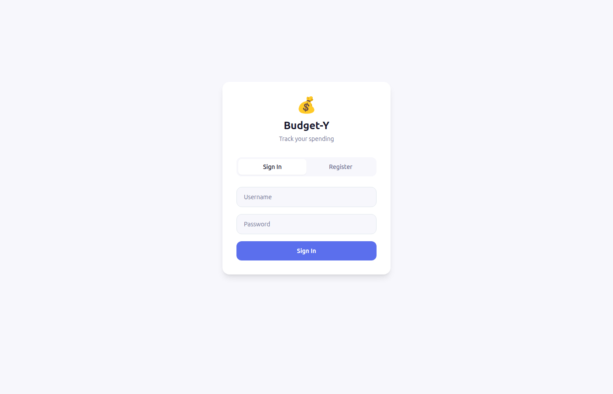
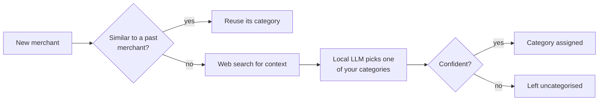
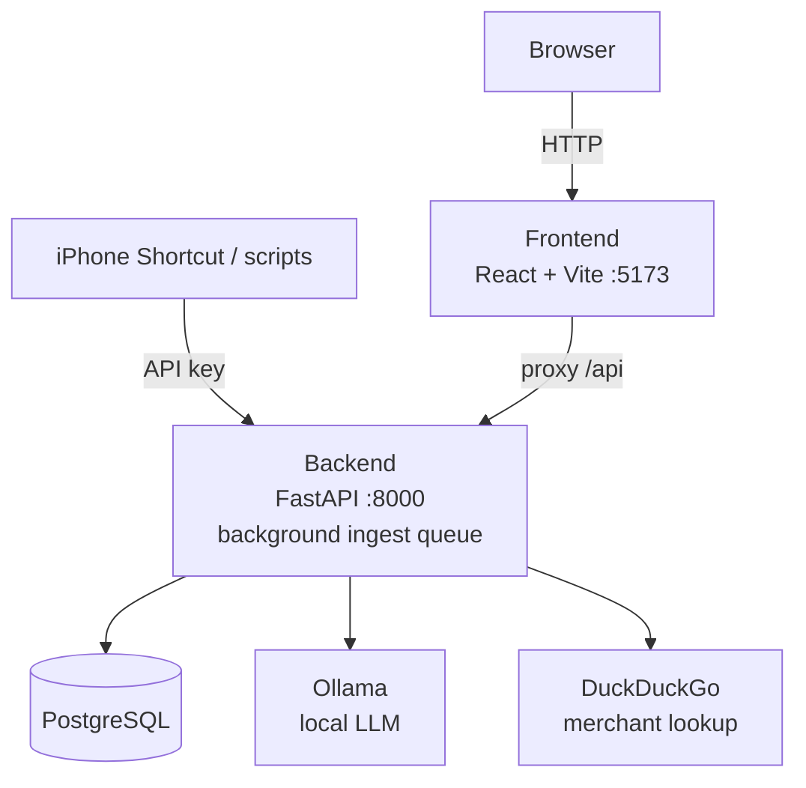
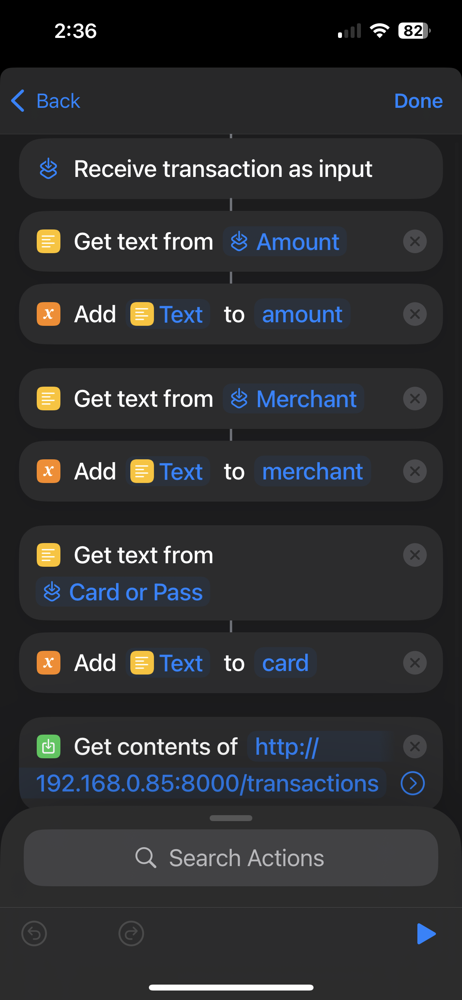
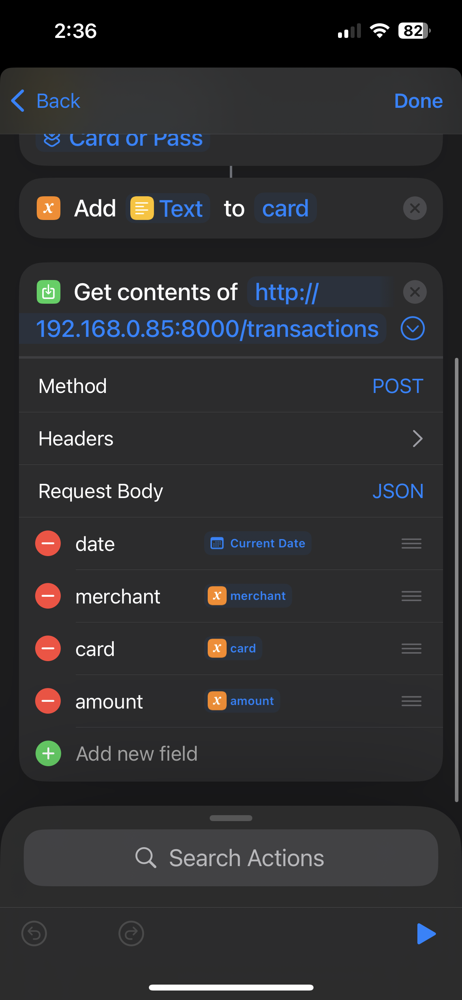

<div align="center">

# Budget-Y

**A self-hosted personal finance tracker.**
Import your bank CSVs, let a local LLM categorise the transactions, and see where your money goes.




</div>

---

## Why Budget-Y

- **Your data stays with you.** No bank APIs, no third-party accounts. Everything runs on your own machine.
- **Local AI.** Categorisation uses a small model running in Ollama. Nothing is sent to a hosted LLM.
- **Simple to run.** Three commands and a `docker compose up`.
- **Multi-user.** Each person signs up with a username and password and only sees their own data.

## Features

- Import transactions from a CSV export, or add them one at a time
- Automatic categorisation of merchants
- Dashboard with monthly spend by category, budget vs actual and savings trend
- Per-category budget limits
- Recurring items
- Edit, filter and search transactions, and bulk-change categories
- API keys so scripts and the iOS Shortcut can add transactions

## Quick start

You need [Docker](https://docs.docker.com/get-docker/) with the Compose plugin and about 2 GB of free disk space for the model.

```bash
# 1. Get the code
git clone https://github.com/<your-username>/budget-y.git
cd budget-y

# 2. Create your config
cp .env.example .env

# 3. Start everything
docker compose up -d --build
```

Open **http://localhost:5173/app/**, choose **Register**, and create your account.

The first start pulls the language model, which can take a few minutes. Follow its progress with:

```bash
docker compose logs -f ollama
```

Transactions still import while the model is downloading. They just stay uncategorised until it is ready.

### Before you expose it to anyone else

Registration is open, so anyone who can reach the app can create an account. If you put it on a network or the internet, only share the URL with people you trust, or put it behind a VPN such as Tailscale or an authenticating reverse proxy.

## Configuration

Everything is set in `.env`. The defaults in `.env.example` work for a local Docker Compose setup.

| Variable | Default | Purpose |
|---|---|---|
| `POSTGRES_USER`, `POSTGRES_PASSWORD`, `POSTGRES_DB` | `budgety`, `changeme`, `budgety` | Database credentials. Change the password. |
| `DATABASE_URL` | `postgresql+psycopg://budgety:changeme@db:5432/budgety` | Must match the values above. Keep the `+psycopg`. |
| `OLLAMA_URL` | `http://ollama:11434` | Where the backend reaches Ollama |
| `OLLAMA_MODEL` | `qwen2.5:1.5b` | Model used for categorisation. Larger models are more accurate. |
| `VITE_BACKEND_URL` | `http://backend:8000` | Where the frontend proxies `/api` requests |

To use a different model, change `OLLAMA_MODEL` and run `docker compose up -d` again. It is pulled automatically.

## Using it

1. **Register.** The first account also adopts any data that existed before accounts were added.
2. **Create categories** such as Groceries, Eating Out and Transport, and optionally set a monthly budget for each. The categoriser only chooses from your own categories.
3. **Upload a CSV** from your bank. Progress is shown while rows are processed.
4. **Review the dashboard** and fix any categories the model got wrong. Budget-Y learns from your corrections for next time.

### CSV format

The format is detected automatically.

| Format | Header row | Columns |
|---|---|---|
| Headerless (for example ANZ) | No | `date, amount, description` |
| Headered | Yes | an `amount` column, plus `merchant` or `description`. `date` and `card` are optional. |

Dates can be `YYYY-MM-DD` or `DD/MM/YYYY`. Credit card payment lines ("thank you for your payment") are skipped, and rows that match an existing transaction are reported as duplicates instead of being added twice.

## How categorisation works



1. **Fuzzy match.** The merchant name is cleaned of locations and compared with your earlier transactions (similarity of 0.8 or higher). This is instant and needs no model.
2. **Web search plus LLM.** Unknown merchants get a short DuckDuckGo snippet for context. The model then picks one of your categories, or answers "none".
3. **Never blocks.** If the model is slow, offline or unsure, the transaction is saved uncategorised and you can set the category yourself.

CSV uploads run through a single background worker inside the API, so large files do not tie up your browser. No separate queue service or broker is needed.

## Architecture



| Layer | Tech |
|---|---|
| Backend | FastAPI, SQLAlchemy, PostgreSQL |
| Frontend | React, Vite, Tailwind, Recharts |
| LLM | Ollama (`qwen2.5:1.5b` by default) |
| Merchant search | DuckDuckGo via `ddgs`, no API key |
| Auth | Username and password (scrypt), 30-day login sessions, per-user API keys |
| Infra | Docker Compose |

## Adding transactions from your phone

Create an API key in the app, then send each purchase to the API. The transaction is saved to the account that owns the key.

```bash
curl -X POST http://<your-host>:5173/api/transaction \
  -H "Authorization: Bearer <your-api-key>" \
  -H "Content-Type: application/json" \
  -d '{"merchant": "Coles", "amount": 42.50, "card": "ANZ"}'
```

This is what the iOS Shortcut does:

<table>
<tr>
<td width="50%"></td>
<td width="50%"></td>
</tr>
</table>

For this to work from outside your home network, the host needs to be reachable from your phone. A VPN such as Tailscale is the simplest way to do that without opening ports.

## Everyday commands

```bash
docker compose up -d --build      # start, or rebuild after pulling updates
docker compose logs -f backend    # follow backend logs
docker compose down               # stop (data is kept)
docker compose down -v            # stop and DELETE all data
```

Data lives in two Docker volumes: `pg_data` (your transactions) and `ollama_data` (downloaded models).

### Backup and restore

```bash
# Backup
docker compose exec -T db pg_dump -U budgety budgety > backup.sql

# Restore into a fresh database
docker compose exec -T db psql -U budgety budgety < backup.sql
```

If you changed `POSTGRES_USER` or `POSTGRES_DB`, use those values instead.

## Troubleshooting

**The page says the host is not allowed.** The dev server only accepts `localhost` by default. If you serve it on another hostname, add it to `server.allowedHosts` in `frontend/vite.config.js`.

**Nothing gets categorised.** Check that the model has finished downloading with `docker compose logs ollama`, and that you have created at least one category.

**Backend cannot connect to the database.** `DATABASE_URL` must use the host `db` (not `localhost`) when running under Docker Compose.

**Running without a GPU is slow.** Small models work fine on CPU. Keep `qwen2.5:1.5b`, or uncomment a GPU reservation for the `ollama` service if you have one.

## Project layout

```
api/         FastAPI backend (auth, transactions, categories, categoriser)
frontend/    React dashboard
docs/        Diagrams and screenshots
docker-compose.yml
.env.example
```

## Credits

The frontend was built with Claude Code (Anthropic).
